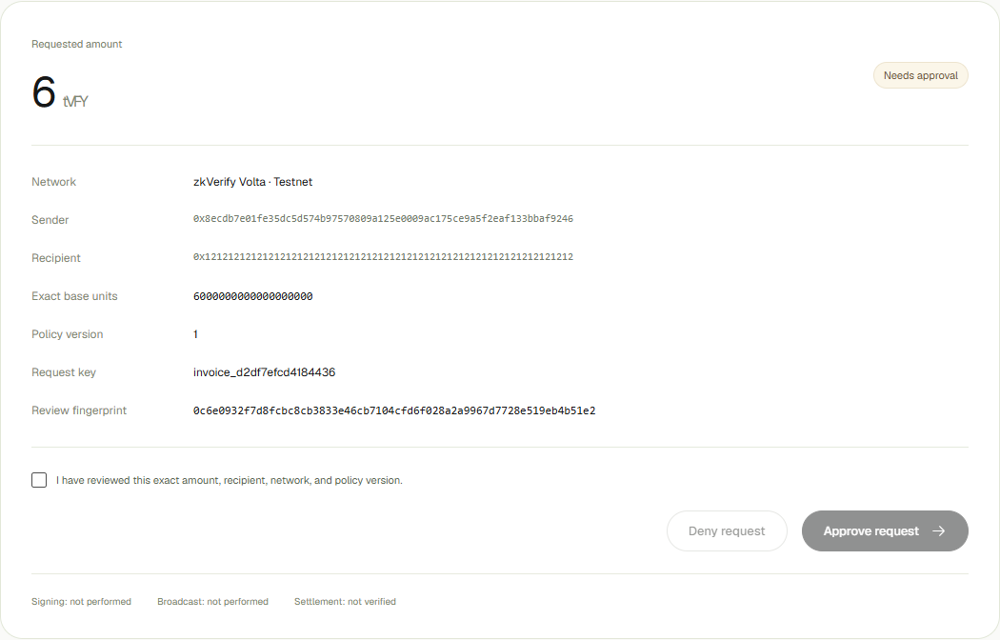
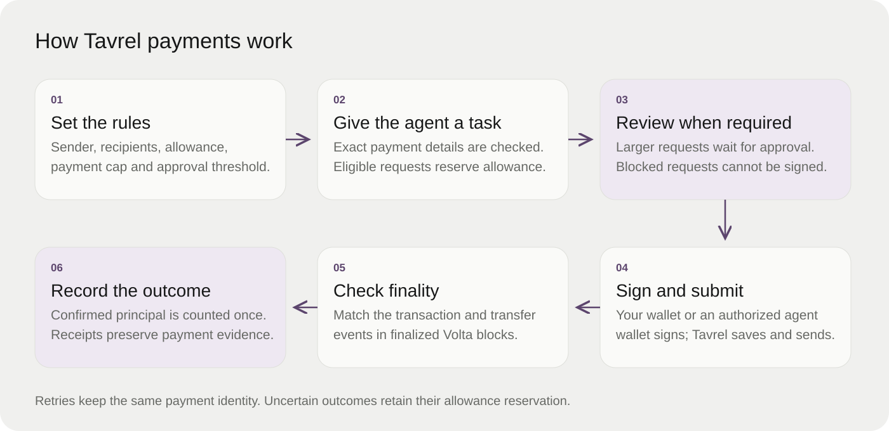
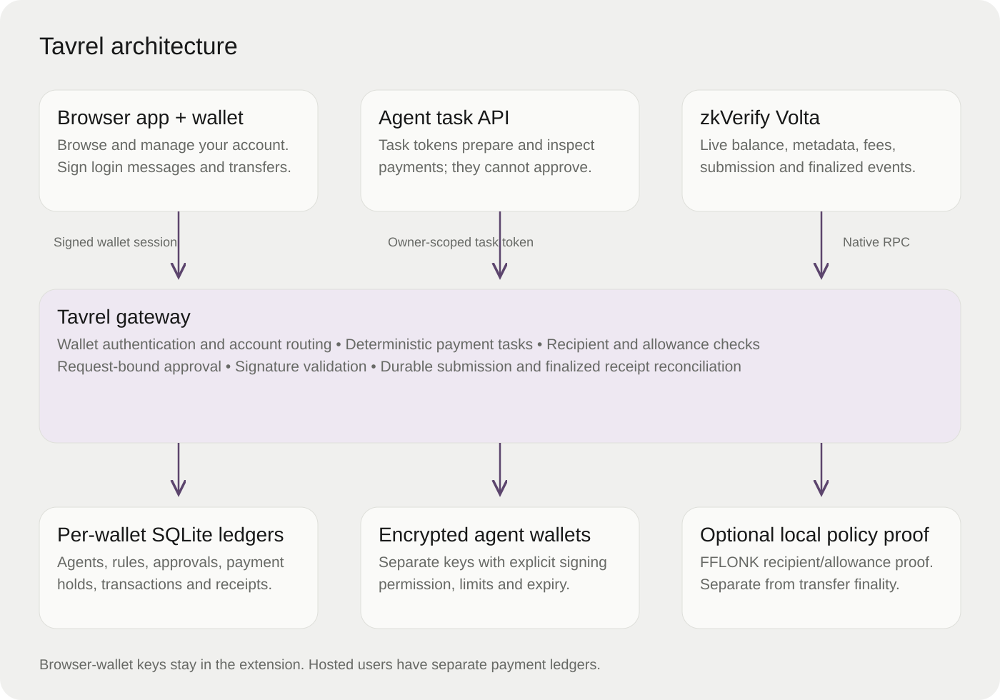

<p align="center"></p>
<h1 align="center">Tavrel</h1>
<p align="center">Agentic payments. On your terms.</p>

**Tavrel is an agentic payments app built on zkVerify.** Give agents payment tasks and decide when human approval is needed. You can sign payments yourself or enable automatic payments, then track every request and confirmation in one place.


## Table of contents

- [The problem](#the-problem)
- [What we built](#what-we-built)
- [How it works](#how-it-works)
- [Judge Guide](#judge-guide)
- [Getting started](#getting-started)
- [Connecting an agent](#connecting-an-agent)
- [Invoice tasks](#invoice-tasks)
- [Automatic agent-wallet payments](#automatic-agent-wallet-payments)
- [zkVerify and test tokens](#zkverify-and-test-tokens)
- [Optional policy proof](#optional-policy-proof)
- [Architecture](#architecture)
- [Tests and evidence](#tests-and-evidence)
- [Capabilities and limits](#capabilities-and-limits)
- [Project context and references](#project-context-and-references)
- [License](#license)

## The problem

Delegating payments to an agent should not mean giving it unrestricted access to your money. A wrong recipient, a payment above your budget, or a repeated request can move funds you did not intend to spend.

People need a way to let agents handle payment work while setting clear limits, approving sensitive requests, and checking what happened to each transfer. Tavrel brings those controls into one app.

## What we built

| Part | Behavior |
| --- | --- |
| Agents | A sender wallet, allowance, cap, approval threshold, approved recipients, pause/resume, and restricted API connection. |
| Invoice task runner | Submit real invoice instructions, report decisions, link requests for review, and watch payment status. |
| Invoice tasks | Process 1–20 exact invoices with durable activity, recipient/allowance decisions, cancellation, and safe resume. |
| Agent wallet | Generate a separate encrypted signing key; authorize a policy version and expiry for automatic eligible transfers. |
| Rules engine | Exact 18-decimal amounts, atomic account/agent reservations, recipient checks, policy version checks, and stable retry keys. |
| Approvals | Review the exact payment. Approval cannot bypass a budget or recipient rule. |
| Wallet access | Server-verified Substrate signed-message login and revocable sessions. |
| Payment execution | Live balance/fee review, wallet transfer signatures, cryptographic payload validation, durable native submission, and recovery. |
| Settlement | Scan finalized blocks and match the transaction, sender, recipient, amount, success, and transfer event. |
| Receipts | Explorer links and downloadable payment evidence with finalized block and transaction index. |
| Optional proof | Generate a real FFLONK artifact for recipient membership and amount limits against a committed policy snapshot. |


<p align="center"><sub>Product preview captured from the app with an isolated test account; it is not evidence of a live transfer.</sub></p>

## How it works

1. Set the shared account allowance and the agent's sender, recipients, cap, and review threshold.
2. Name a payment task and enter each invoice's reference, recipient, exact amount, and purpose. The agent validates the entire input before preparing any request.
3. Tavrel checks the rules. An eligible request reserves its principal; a prohibited request is recorded as blocked.
4. Approve qualifying requests after reviewing their exact details. Rules are checked again if they change.
5. The app checks the real network fee and balance. Your wallet signs the native transfer, or a separately authorized agent wallet signs an eligible request automatically.
6. Tavrel verifies the signature and saves the signed transaction before submitting it. Recovery reuses those signed bytes.
7. A matching successful transfer in a finalized block moves principal from reserved to spent. The request receives a downloadable receipt.



The shared and agent allowances track **principal**, with available allowance equal to limit minus confirmed principal minus active reservations. Network fees are paid separately by the sender. Allowances are not deposits or wallet balances.

## Judge Guide

Use the [live app](https://tavrel-production.up.railway.app) to try the workflow. You need a Substrate wallet such as **SubWallet** and **tVFY test tokens**. Sign-in needs no tokens.

### 1. Open the app and connect

Choose **Launch app**, then **Connect wallet**. Select your extension and account, and sign the login message. Your wallet opens its own account.

Get test tokens from the **Get test tokens** footer link or the [Volta faucet](https://www.faucy.com/zkverify-volta). Fund the wallet you plan to use as the sender.

### 2. Set up one agent

In **Settings**, set your account allowance to **0.1 tVFY**. Then open **Agents**, create an agent, and save these payment rules:

| Setting | Value to try |
| --- | --- |
| Sender | Your funded wallet's public address |
| Agent allowance | `0.1` tVFY |
| Per-payment cap | `0.03` tVFY |
| Approval above | `0.01` tVFY |
| Recipient | Name it `test_recipient` and use a second wallet address you control |

The allowance limits spending; it does not fund the wallet. Keep enough tokens for the payment and network fee.

### 3. Start a payment task

Open your agent and find **Give your agent a task**. Name it **Payment check**, then enter these two payments. Use **Add invoice** for the second row:

| Reference | Recipient | Amount | Purpose |
| --- | --- | --- | --- |
| `CHECK-001` | `test_recipient` | `0.005` tVFY | Small payment |
| `CHECK-002` | `test_recipient` | `0.02` tVFY | Payment needing approval |

Choose **Start task**. The agent checks the details and rules, then prepares both requests. No model or API key is needed.

**Check:** the first request says **Ready to send**. The second says **Needs approval**.

### 4. Approve and send

Open the first payment, review its details, tick the confirmation box, and choose **Review fees**. If the balance is sufficient, choose **Sign and send** and confirm in your wallet.

For the second payment, open **Approvals**, approve the request, then review fees and sign it.

**Check:** each successful transfer progresses through **Sending → Awaiting confirmation → Confirmed**. Chain confirmation can take time; you can return to the payment later.

### 5. Verify the result

Open **Ledger**, select the confirmed payment, and choose **View transaction**. In the explorer, compare the **sender, recipient, amount, and transaction hash**, and check the finalized result. **Download receipt** saves the recorded evidence.

**Check:** the payment's principal is counted as spent once. The network fee is separate. A submission response alone is not a confirmed payment.

### Extra checks

| Action | Expected result |
| --- | --- |
| Request `0.031` tVFY with these rules | Blocked by the per-payment cap |
| Use a valid recipient address absent from the allowed list | Blocked before signing |
| Repeat the same reference and payment details | Returns the existing request without a duplicate payment |
| Change the amount under the same reference | Rejects the conflicting request |

If a request is blocked, read its reason, correct the rule or details, and create a new request with a new reference. If the sender needs tokens, use the faucet. For automated verification and known limits, see [Tests and evidence](#tests-and-evidence) and the [public Docs](https://tavrel-production.up.railway.app/docs).

## Getting started

Requirements: **Python 3.11+**, **Node 24.22.1+**, npm, and a Substrate browser wallet for account actions. Node's version matches the requirement of `zkverifyjs@3.4.0`.

```bash
git clone https://github.com/eminentcodes/tavrel.git
cd tavrel
python -m pip install -e .
npm ci
npm run build
python -m tavrel serve
```

Open the printed address, normally `http://127.0.0.1:8787`. The build produces the frontend and bundled Node helpers. Runtime data lives in `.tavrel/`, which is excluded from Git. Use a different `--data-dir` for a separate installation.


This command starts the local app. You can also use the [live app](https://tavrel-production.up.railway.app).


## Connecting an agent

Choose **Agent connection → Create and download**. Keep the connection JSON private; creating it revokes the previous task token. Your own automation can use the task-scoped API, or run the included deterministic CLI with a JSON array containing `recipient`, `amount`, and `purpose`:

```bash
python -m tavrel.agent TASK_ID --connection TASK_ID-connection.json --file invoices.json --key invoice-batch --watch 600
```

The CLI reports each decision and follows payment status while you review requests. Reuse its task key and exact ordered file when retrying. UI invoice references and CLI batch keys identify their own requests; choose one submission route for an invoice rather than submitting it through both.

## Invoice tasks

The app agent validates 1–20 invoices, resolves approved recipient names to public accounts, checks the current rules, and prepares requests in order. Required details are explicit fields; it does not interpret natural-language instructions or invent missing information. Its durable activity records rule checks, invoice counts, each payment outcome, and completion.

Task-token clients can `POST /v1/agent/runs` with `goal` (a task name), `invoices`, and a stable `request_key`:

```json
{
  "goal": "Service invoices",
  "request_key": "service-invoices-november",
  "invoices": [
    {"invoice_reference":"INV-001","recipient":"service_vendor","amount":"0.005","purpose":"First service invoice"}
  ]
}
```

List/get scoped runs and use `/resume` or `/cancel`. The same reference within an agent identifies the same payment across app batches; changed details conflict rather than replacing that payment. Different references can identify separate invoices with equal amounts. A restarted or interrupted task requires explicit resume and reuses saved requests. Cancellation stops future invoice preparation; existing payments, holds, and automatic-wallet permissions still apply.

A blocked request remains history. After correcting rules, use a clearly revised reference such as `INV-001-retry2` to request a fresh review. Earlier model-task records remain under **Earlier tasks** and cannot execute again. The current app makes no model calls and has no model-provider configuration.

## Automatic agent-wallet payments

To pay without signing each transfer:

1. Open the agent and choose **Create agent wallet**.
2. Fund its displayed public address with tVFY using the faucet or a transfer you authorize.
3. Set that address as the sender in the agent's policy. Set recipients, principal allowance, cap, and approval threshold.
4. Review the estimated fee cap and permission duration, tick the authorization box, then choose **Enable automatic signing**.
5. Start an invoice task. Eligible payments are signed and submitted automatically; requests above the threshold still require your approval in the app.

Permission is bound to the reviewed policy version, expires after 1–168 hours, and can be disabled. A policy change or pause stops new automatic signing. Disabling does not cancel previously stored signed transactions or release payment holds; existing transaction recovery continues.

The app holds the **separate agent wallet's encrypted key**. Your connected wallet's private key remains in its extension. Limits are enforced by Tavrel's server, rather than ARCANUM-style smart contracts, so keep only the funds you intend to delegate in the agent wallet. Fees are paid separately; the fee cap checks the current estimate and cannot guarantee the final fee charged by the chain.

Windows uses profile-bound DPAPI to protect the encryption key. On other systems set `TAVREL_WALLET_VAULT_KEY` to a Fernet key in the server environment before creating wallets. Preserve the encrypted ledger and original vault key/profile; losing them loses access to agent-wallet funds. Never commit or pass the vault key to an agent.

| Method | Task-scoped endpoint | Purpose |
| --- | --- | --- |
| GET | `/v1/agent/payments/status` | Read this agent's allowance, policy, and requests. |
| POST | `/v1/agent/payments/prepare` | Prepare one invoice using recipient, amount, purpose, and request key. |
| POST | `/v1/agent/payments/task` | Submit an ordered task with a stable task key and 1–20 invoices. |
| GET | `/v1/agent/payments/PAYMENT_ID` | Follow the request and its eventual receipt. |
| POST / GET | `/v1/agent/runs` | Start or list exact invoice tasks. |
| GET | `/v1/agent/runs/RUN_ID` | Read durable activity and payment outcomes. |
| POST | `/v1/agent/runs/RUN_ID/resume` or `/cancel` | Resume an interrupted task or stop future invoice preparation. |

Authenticate using the connection file's task token in `Authorization: Bearer TOKEN`. The token is restricted to its own agent. Keep connection files outside version control; do not give an agent access to the server's data directory.

Agents cannot modify policies, approve payments, create wallet sessions, request signing quotes, or submit signatures. The person uses the app for those operations.

## zkVerify and test tokens

| Property | Value |
| --- | --- |
| Network | zkVerify Volta testnet |
| Asset | Native **tVFY**, 18 decimal places |
| Transfer | `balances.transferKeepAlive` |
| RPC | `https://volta-rpc.zkverify.io` for the server's native operations |
| WebSocket | `wss://volta-rpc.zkverify.io` / `wss://zkverify-volta-rpc.zkverify.io` |
| Genesis | `0xff7fe5a610f15fe7a0c52f94f86313fb7db7d3786e7f8acf2b66c11d5be7c242` |
| Explorer | [Volta Subscan](https://zkverify-testnet.subscan.io) |
| Faucet | [Faucy](https://www.faucy.com/zkverify-volta) |

tVFY is a **test token**, not a stablecoin. The build uses the sponsor's native chain for actual payment submission and finality checks, rather than adding an unrelated EVM network.

The faucet currently asks you to connect a wallet and complete a CAPTCHA. Its displayed claim amount and availability can change. Official guidance: [Getting testnet tokens](https://docs.zkverify.io/overview/getting-started/get_testnet_tokens).

## Optional policy proof

The checkable claim is: **this exact payment's recipient belongs to the committed approved-recipient tree, and its positive amount fits the committed per-payment cap and remaining account/agent allowances.**

The circuit binds that claim to the sender, recipient, exact amount, approval fingerprint, and Volta genesis hash. A single Poseidon public commitment fits zkVerify's FFLONK verifier. The recipient tree and allowance values remain private in the proof artifact. The optional circuit supports up to **eight approved recipients**; ordinary payment policies support larger lists.

The proof establishes those checks against the supplied commitment. It does not independently authenticate the server's policy snapshot, enforce wallet policy on chain, prove external service delivery, or prove that a transfer settled. Settlement has its own chain receipt.

Build the proving artifacts from the pinned public PSE ceremony file:

```bash
curl -fL https://pse-trusted-setup-ppot.s3.eu-central-1.amazonaws.com/pot28_0080/ppot_0080_16.ptau -o ppot_0080_16.ptau
npm run proof:setup -- ppot_0080_16.ptau
```

Setup checks the file's pinned SHA-256, compiles the circuit, and derives the FFLONK key from the published PSE ceremony. It relies on that published ceremony; checksum verification is not an independent cryptographic recheck of its transcript. Add `--verify-ceremony` to recheck the full ceremony, including its expensive beacon computation, which can take hours. The manifest records whether that recheck completed. Large setup files and generated keys are excluded from Git.

After generating a payment proof in the app, verify its downloaded JSON:

```bash
node scripts/verify-policy-proof.mjs PAYMENT_ID-policy-proof.json
```

Run `npm run proof:check` for actual proof generation, verification after JSON key reordering, and rejection of changed payment claims, proof data, and allowance overflows. These checks use isolated test instructions and make no chain calls.

Verification uses the public circuit key and manifest included in [proofs](proofs), and recomputes the public commitment and proof reference. Verifying a downloaded artifact does **not** require the large SRS or proving-key setup. A downloaded artifact's own `locally_verified` field is not trusted as verification.

The bundle's SHA-256 reference identifies the actual artifact. `zkverify_transaction` stays `null` until a real proof transaction is submitted and verified; no submission is claimed merely from local verification or native tVFY settlement.

## Architecture



| Source | Responsibility |
| --- | --- |
| [frontend/src](frontend/src) | Landing, public Docs, agent management, recipients, approvals, ledger, wallet review, and receipts. |
| [payments.py](tavrel/payments.py) | Exact units, budgets, reservation accounting, permissions, and review hashes. |
| [settlement.py](tavrel/settlement.py) | Signing quotes, durable transaction records, recovery, expiry, and finality accounting. |
| [native_rpc.mjs](tavrel/native_rpc.mjs) | Live metadata/balance/fee reads, signature inspection, native submission, finalized block/event scanning. |
| [auth.py](tavrel/auth.py) | Registered wallet ownership, expiring login challenges, replay prevention, and revocable sessions. |
| [accounts.py](tavrel/accounts.py) | Separate hosted wallet ledgers, legacy-owner preservation, and owner-scoped task-token routing. |
| [agent.py](tavrel/agent.py) | Invoice task execution and status watching through restricted agent APIs. |
| [agent_runs.py](tavrel/agent_runs.py) | Deterministic invoice validation, durable action plans, scoped runs, and retry identities. |
| [wallet_verifier.py](tavrel/wallet_verifier.py) | Reuses native crypto for wallet login with bounded waits and independent request IDs. |
| [agent_wallets.py](tavrel/agent_wallets.py) | Separate encrypted wallets and explicit bounded automatic-signing permissions. |
| [server.py](tavrel/server.py) | App/API routes, authentication, origin checks, and reconciliation lifecycle. |
| [proofs](proofs) | Optional payment-policy circuit and witness/commitment construction. |
| [tests](tests) | Behavioral and cryptographic verification with isolated fixtures. |

Python and SQLite provide the authorization boundary. Amounts are decimal text in SQLite and Python integers during atomic transactions, so 18-decimal values do not overflow SQLite's signed integer range. The invoice agent executes a bounded saved action plan. Signing belongs either to the browser wallet or the separately authorized encrypted agent wallet. Node helpers use current chain metadata and cryptographic primitives.

The app routes are `/dashboard`, `/agents`, agent details/policies, `/vendors`, `/approvals`, `/ledger`, payment details, and `/settings`. `/docs` is public and linked from the landing navigation/footer.

## Tests and evidence

Run:

```bash
python -W error::ResourceWarning -m unittest discover -s tests
node --test tests/native-signing.test.mjs tests/wallet-connection.test.mjs tests/wallet-login.test.mjs tests/agent-wallet.test.mjs tests/api.test.mjs
npm run check:ui
node scripts/check-native-rpc.mjs
npm audit
```

The backend verification covers payment rules, wallet login, standalone invoice execution, proof snapshot caching, and recovery. Signature tests reject changes to the call, nonce, mortality, genesis, runtime versions, tip, and signer. Settlement tests cover identical retries, restart recovery, uncertain node responses, finalized success/failure, forged receipt rejection, expiry, and exact-once principal accounting. Current counts and timings are in the verification record.

After proof setup, run `node --test tests/policy-proof.test.mjs` to check the actual compiled circuit's constraints and `npm run proof:check` to exercise the full FFLONK pipeline.

| Evidence | What it establishes |
| --- | --- |
| [Verification record](artifacts/verification.md) | Commands, observed results, and their limits. |
| [Native RPC check](artifacts/native-rpc-check.json) | Real Volta fee/balance/nonce/finality reads and signing-payload preparation; no signing or submission. |
| [Sponsor SDK check](artifacts/zkverify-network-proof.json) | Live sponsor chain properties and an unsigned SCALE transfer round trip. |
| [Browser record](artifacts/ui/frontend-proof.json) | App browsing, wallet message authentication, policy/approval flow, images, and responsive layout; the file labels its test provider and network coverage. |
| [Settlement tests](tests/test_settlement.py) | Controlled RPC responses verify authorization, reservations, recovery, and receipt accounting. |
| [Cryptographic tests](tests/native-signing.test.mjs) | Offline signatures verify against stored public chain payloads. |
| [Wallet connection tests](tests/wallet-connection.test.mjs) | Selected native access, bounded waiting, retry after timeout/cancellation, unsupported account filtering, and exact payment payloads. |
| [Wallet login tests](tests/wallet-login.test.mjs) | Cancelled or timed-out signatures never reach verification; successful login signs the exact challenge once. |
| [Signature-worker tests](tests/test_wallet_verifier.py) | Actual signatures, changed claims, concurrent callers, worker recovery, and fail-closed timeouts. |
| [Hosted tests](tests/test_hosted.py) | HTTPS domain validation, Railway health checks, pinned wallet ownership, actual message signatures, and Secure login/logout cookies. |
| [Public account tests](tests/test_public_accounts.py) | Two actual wallet signatures, separate agents/allowances/invoices, cross-account rejection, token rotation, session/restart persistence, atomic registration rollback, and legacy migration/data preservation. |
| [Packaged hosted runtime](artifacts/railway-package-check.json) | Built wheel starts without a preset owner outside the source tree, serves frontend assets, verifies a real wallet self-registration signature, and derives an agent-wallet address using bundled helpers without runtime node_modules. |
| [Live app availability](artifacts/railway-live-check.json) | Railway health, public HTML/assets, and anonymous access checks passed. Installed-wallet login and funded transfers are separate checks. |
| [Latest wallet browser record](artifacts/ui/wallet-connection-proof.json) | Modal-close cancellation, ignored late replies, retry, actual native-signature login, and removal of Cancel connection. Live balance and installed extension speed are outside this focused check. |
| [Verifier timing record](artifacts/wallet-verifier-check.json) | Three cold and three reused native-verifier calls with an offline fixture; excludes extension and human signing time. Reproduce with `python scripts/check-wallet-verifier.py`. |
| [Invoice task tests](tests/test_agent_runs.py) | Input validation, exact ledger outcomes, scoped access, duplicate references, crash recovery, cancellation, recipient binding, and retained historical runs. |
| [Agent-wallet tests](tests/test_agent_wallets.py) | Encrypted keys, version/expiry/sender permissions, required approval, funding/fee checks, and revocation before durable transaction storage. |
| [Policy proof checks](artifacts/policy-proof-check.json) | Twelve actual FFLONK generation/verification cases, including altered claims and allowance overflows. |
| [Actual policy artifact](artifacts/payment-policy-proof.json) | A real locally verified proof from isolated test instructions; no on-chain proof or payment transaction. |

Tests do not spend funds. A funded installed-wallet transfer must be confirmed by its user and checked on the explorer before claiming an observed live settlement. Controlled test receipts and product screenshots are not live transaction evidence.

## Capabilities and limits

- Transfers use a user's Substrate wallet and native Volta tVFY. Stablecoins, contract wallets, swaps, and commercial x402 service purchasing are not implemented.
- Rules cover Tavrel's API. They do not constrain a wallet owner who sends directly elsewhere. Agents must be isolated from server credentials and files.
- Manual payments use the browser wallet. Optional automatic payments use a separate encrypted agent wallet after explicit permission.
- A saved signature stays bound to its reviewed call, nonce, network, and mortal era. Uncertain outcomes retain reservations until finalized success, failure, or verified expiry.
- Confirmed principal reduces the remaining allowance; fees are tracked separately when emitted by the chain.
- App invoice tasks and the deterministic CLI use the same payment ledger. Explicit invoice details drive execution; natural-language reasoning, external invoice fetching, and LLM calls are not included.
- Railway configuration and hosted authentication are implemented. Deployed-service behavior, hackathon submission, and funded-wallet settlement require their own observed results.

## Project context and references

Built for [Agent Games Wildcard](https://agentgames.zkverify.io/events/wildcard) under agentic payments. This entry focuses on the useful problem, a reviewable working workflow, clear capability boundaries, and optional checkable policy evidence.

- [zkVerify documentation](https://docs.zkverify.io/)
- [zkverifyjs](https://github.com/zkVerify/zkverifyjs)
- [SubWallet](https://www.subwallet.app/)
- [Talisman](https://talisman.xyz/)
- [PSE Perpetual Powers of Tau](https://github.com/privacy-scaling-explorations/perpetualpowersoftau)
- [snarkjs](https://github.com/iden3/snarkjs) and [circomlib](https://github.com/iden3/circomlib)

Dependency licenses apply to their respective code. The optional proof tooling uses GPL-licensed snarkjs/circomlib; compiler/setup outputs are generated from the linked source and published ceremony.

## License

Tavrel's source code is licensed under the [MIT License](LICENSE).